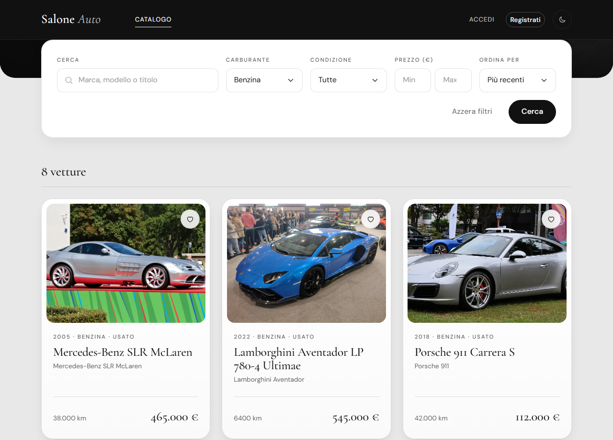
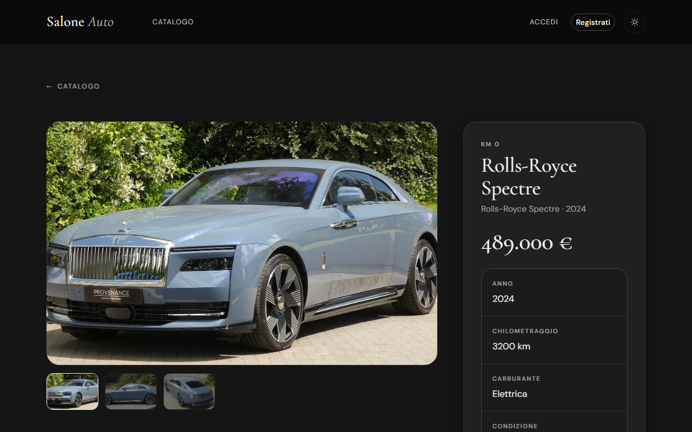
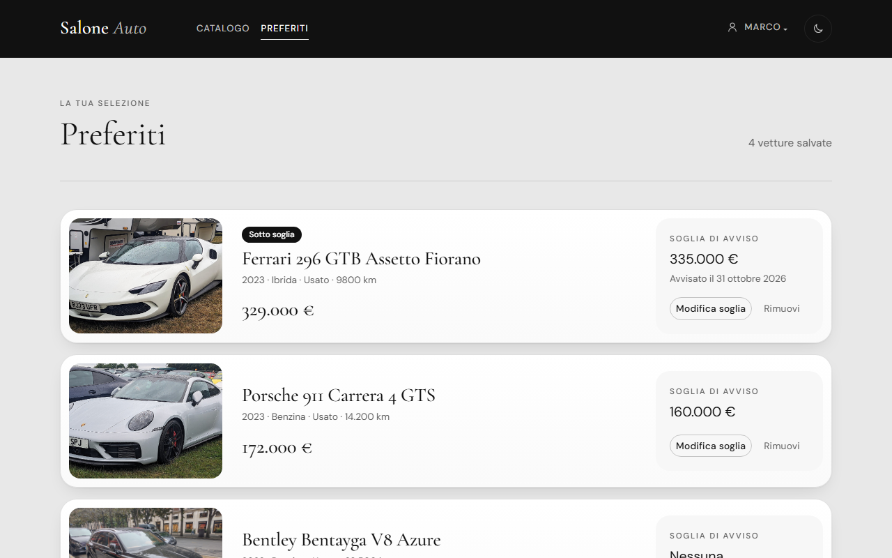
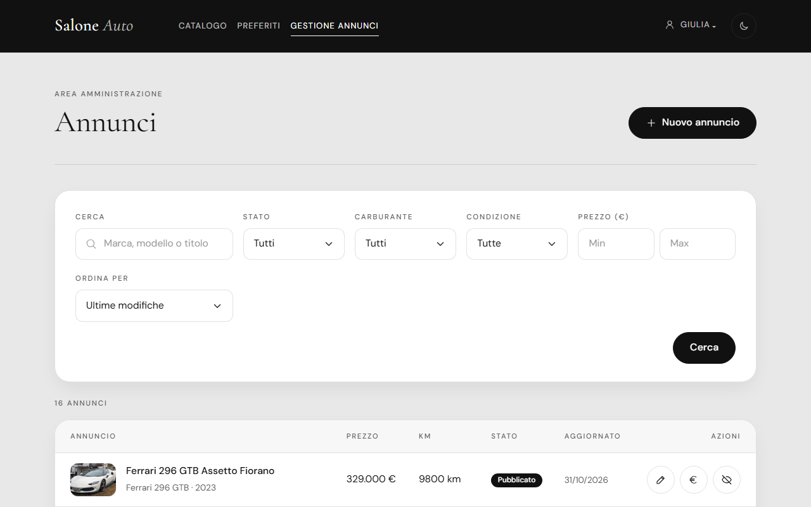
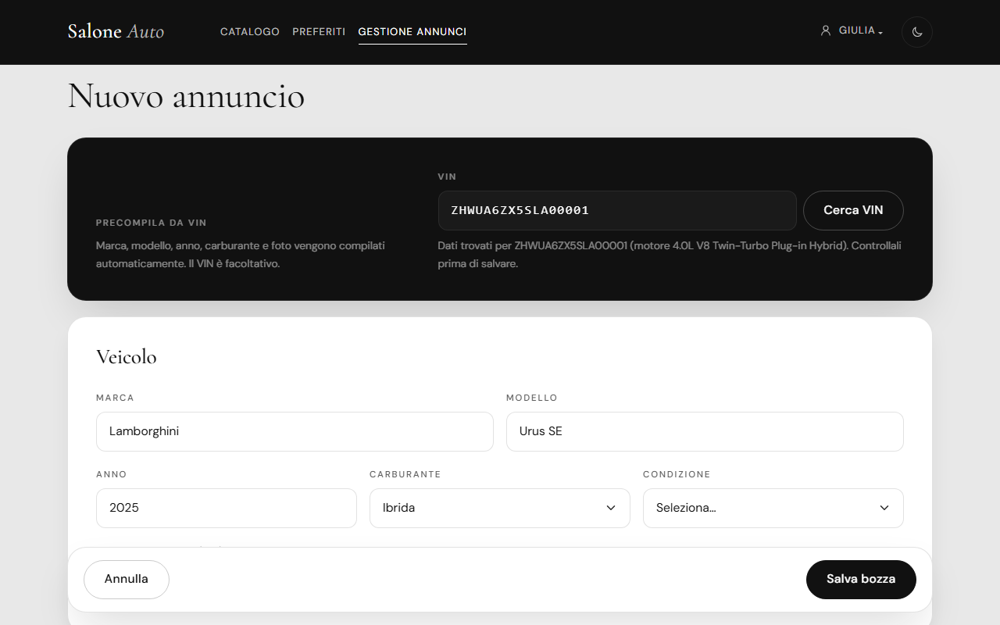

🇮🇹 Italiano · 🇬🇧 [English](README.md)

# Luxury Car Showroom

Web app full stack per un concessionario di auto di lusso: un catalogo pubblico degli annunci, un'area utente con preferiti e avvisi email quando il prezzo scende, e un pannello admin per gestire gli annunci, con decodifica del VIN e import del catalogo da [auto.dev](https://auto.dev).

Realizzato come progetto del corso di [EPICODE Institute of Technology](https://epicode.com): REST API in Spring Boot + SPA in React. L'interfaccia è in italiano.

<p align="center">
  
</p>

<table>
  <tr>
    <td></td>
    <td></td>
  </tr>
  <tr>
    <td align="center">Dettaglio auto (tema scuro)</td>
    <td align="center">Preferiti con soglie di prezzo</td>
  </tr>
  <tr>
    <td></td>
    <td></td>
  </tr>
  <tr>
    <td align="center">Admin: annunci</td>
    <td align="center">Admin: form annuncio precompilato dal VIN</td>
  </tr>
</table>

## Funzionalità

**Autenticazione**
- Registrazione con verifica dell'email: il link vale 24 ore e si può richiedere di nuovo; gli account non verificati non possono accedere.
- Login JWT stateless con email o username; password salvate con hash BCrypt.
- Reset della password via email con un link monouso valido 15 minuti. La risposta è la stessa che l'account esista o no, e nemmeno i tempi di risposta del login lo rivelano.
- I token di verifica e di reset sono salvati solo come hash SHA-256.

**Ruoli e rotte protette**
- Ruoli `USER` e `ADMIN`, inclusi nel JWT. `/api/admin/**` richiede `ADMIN`; i preferiti richiedono il login.
- Il frontend replica le regole con route guard (`RequireAuth`, `RequireAdmin`, `GuestOnly`).
- Al primo avvio viene creato un super admin a partire dalle variabili d'ambiente.

**Catalogo**
- Filtri (testo, carburante, condizione, fascia di prezzo), ordinamento e paginazione lato server.
- I campi di ordinamento sono in una whitelist e `id` viene sempre aggiunto come criterio finale, così le pagine restano stabili.
- Filtri, ordinamento e pagina stanno nell'URL: ogni ricerca si può salvare nei preferiti del browser e condividere.
- Pagina di dettaglio con galleria di immagini.

**Preferiti e avvisi di prezzo**
- Gli utenti salvano le auto tra i preferiti e possono impostare una soglia di prezzo su ciascuna.
- Quando un admin abbassa il prezzo sotto la soglia, l'utente riceve un'email. Ogni utente viene avvisato una sola volta; l'avviso si riattiva se il prezzo torna sopra la soglia.

**Pannello admin**
- Tabella degli annunci con filtri per stato, carburante, condizione e prezzo.
- Creazione e modifica degli annunci, cambio rapido del prezzo, pubblicazione e ritiro: un annuncio è in bozza (`BOZZA`) o pubblicato (`PUBBLICATO`), e il catalogo pubblico mostra solo quelli pubblicati.
- Decodifica del VIN: marca, modello, anno, carburante e foto vengono precompilati da auto.dev.

**Import del catalogo**
- Seeder facoltativo che riempie un catalogo vuoto con annunci reali di auto di lusso da auto.dev, divisi per gruppi di marche così che le più diffuse non prendano tutto lo spazio.

**Tema chiaro e scuro**
- Di default segue `prefers-color-scheme`; un interruttore nella navbar salva la scelta.

## Stack tecnologico

| Area | Tecnologia | Versione |
|---|---|---|
| Backend | Java | 25 |
| | Spring Boot (Web MVC, Security, Data JPA, Validation, Mail) | 4.1.1 |
| | Spring Security OAuth2 Resource Server (JWT) | da Spring Boot |
| | Thymeleaf (template delle email) | da Spring Boot |
| | PostgreSQL | 16 (usato in sviluppo) |
| | Lombok | da Spring Boot |
| | H2 (solo test) | da Spring Boot |
| Frontend | React | 19.2 |
| | TypeScript | 6.0 |
| | Vite | 8.3 |
| | React Router | 7.18 |
| | Bootstrap + React-Bootstrap | 5.3 / 2.10 |
| | Sass | 1.105 |
| | Oxlint | 1.81 |
| Servizi esterni | API auto.dev (decodifica VIN, foto, annunci) | |
| | Mailtrap (sandbox SMTP per lo sviluppo) | |

## Architettura

```
BE/   REST API in Spring Boot
  controller/   endpoint REST: /api/auth, /api/cars, /api/me/favorites, /api/admin/**
  service/      logica di business (auth, catalogo, preferiti, reset password, ricerca VIN, email)
  repository/   repository Spring Data JPA e CarSpecifications
  entity/       entità JPA: User, Role, Car, Favorite, token
  dto/          record di richiesta e risposta, con Bean Validation
  event/        PrezzoCambiatoEvent e PriceAlertListener
  security/     JWT, regole di sicurezza, handler ProblemDetail per 401/403
  client/       AutoDevClient (RestClient per auto.dev)
  config/       cache, seeder all'avvio, proprietà di configurazione tipizzate
  exception/    gerarchia delle eccezioni e GlobalExceptionHandler

FE/   SPA in React + TypeScript
  src/api/        client fetch con JWT e funzioni API tipizzate
  src/context/    AuthContext e FavoritesContext
  src/pages/      catalogo, dettaglio, preferiti, pagine di autenticazione, admin/
  src/components/ navbar, filtri, card, galleria, guard, interruttore del tema
  src/utils/      filtri sincronizzati con l'URL, hook per chiamate asincrone e form, formattazione
```

Alcune scelte tecniche:

- **Avviso di prezzo dopo il commit.** Cambiare un prezzo pubblica un `PrezzoCambiatoEvent`. `PriceAlertListener` lo gestisce con `@TransactionalEventListener(phase = AFTER_COMMIT)` e `@Async`: le email partono solo se la modifica è stata davvero salvata, e l'admin non aspetta l'SMTP. Ogni preferito viene segnato come notificato con un `UPDATE` condizionale: solo la chiamata che riesce ad aggiornarlo invia l'email, quindi eventi concorrenti non generano doppioni.
- **Specifications JPA per i filtri.** `CarSpecifications` costruisce un'unica `Specification<Car>` dai filtri facoltativi e ignora quelli vuoti. La ricerca pubblica e quella admin la condividono; quella pubblica forza sempre gli annunci pubblicati.
- **ProblemDetail per gli errori.** Ogni errore delle API esce come `application/problem+json` (RFC 9457): gli errori di validazione elencano i campi non validi, e anche i rifiuti di autenticazione e autorizzazione (401/403) usano lo stesso formato.
- **Cache per auto.dev.** Le ricerche per VIN restano in una cache in memoria con Spring Cache (`@Cacheable`), così ripetere la ricerca dello stesso VIN non consuma la quota limitata dell'API.
- **Test di integrazione.** 46 test in 9 classi coprono il flusso di autenticazione, le regole di sicurezza, i filtri del catalogo, le operazioni admin, gli avvisi di prezzo e il client auto.dev. Girano su un database H2 in memoria, con l'invio email simulato e auto.dev sostituito da uno stub HTTP locale.

## Avvio in locale

### Prerequisiti

- JDK 25
- Node.js 20.19 o successivo
- PostgreSQL
- Una casella di posta [Mailtrap](https://mailtrap.io) per ricevere le email di verifica, reset e avviso di prezzo
- Facoltativo: una API key di [auto.dev](https://auto.dev), per la decodifica del VIN e l'import del catalogo

Se preferisci Docker per il database:

```bash
docker run --name salone-db -e POSTGRES_PASSWORD=postgres -e POSTGRES_DB=salone -p 5432:5432 -d postgres:16
```

### 1. Clona la repo

```bash
git clone https://github.com/TheRedKardinal/luxury-car-showroom.git
cd luxury-car-showroom
```

### 2. Backend

```bash
cd BE
cp .env.example .env     # poi compila i valori (vedi sotto)
./mvnw spring-boot:run   # Windows: mvnw.cmd spring-boot:run
```

L'API parte su `http://localhost:8080`. Lo schema viene creato in automatico, e al primo avvio viene creato il super admin dalle variabili `ADMIN_*`.

### 3. Frontend

```bash
cd FE
cp .env.example .env
npm install
npm run dev
```

L'app si apre su `http://localhost:5173`. Accedi con le credenziali admin di `BE/.env`.

Il catalogo parte vuoto. Puoi aggiungere annunci dal pannello admin, oppure importarli da auto.dev impostando `CATALOG_SEED=true` per un solo avvio e poi di nuovo `false`. L'import consuma 4–8 chiamate della quota auto.dev.

### 4. Test

```bash
cd BE
./mvnw test
```

## Variabili d'ambiente

Modelli: `BE/.env.example` e `FE/.env.example`. I file `.env` sono esclusi da git.

**Backend (`BE/.env`)**

| Variabile | Scopo |
|---|---|
| `DB_URL`, `DB_USERNAME`, `DB_PASSWORD` | Connessione a PostgreSQL |
| `JPA_DDL_AUTO` | Gestione dello schema di Hibernate (facoltativa, default `update`) |
| `JWT_SECRET` | Chiave per firmare i JWT (almeno 32 caratteri) |
| `JWT_EXPIRATION` | Durata del token in formato ISO-8601 |
| `MAIL_HOST`, `MAIL_PORT`, `MAIL_USERNAME`, `MAIL_PASSWORD` | Server SMTP (sandbox Mailtrap in sviluppo) |
| `MAIL_FROM` | Mittente delle email in uscita |
| `FRONTEND_URL` | Origine del frontend, usata per CORS e per i link nelle email |
| `AUTODEV_API_KEY` | API key di auto.dev |
| `CATALOG_SEED` | `true` per importare all'avvio annunci da auto.dev in un catalogo vuoto |
| `ADMIN_USERNAME`, `ADMIN_EMAIL`, `ADMIN_PASSWORD` | Super admin creato al primo avvio |
| `ADMIN_NOME`, `ADMIN_COGNOME` | Nome e cognome del super admin (facoltative) |

**Frontend (`FE/.env`)**

| Variabile | Scopo |
|---|---|
| `VITE_API_URL` | URL base dell'API del backend |

## Autore

Claudio Giasi: [GitHub](https://github.com/TheRedKardinal) · [LinkedIn](https://www.linkedin.com/in/claudio-giasi-8836b5243/)

---

Il progetto non è online: per provarlo, avvialo in locale seguendo [Avvio in locale](#avvio-in-locale).

Foto delle auto: Wikimedia Commons (CC0)
