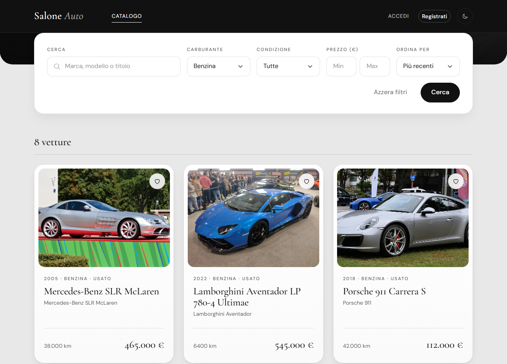
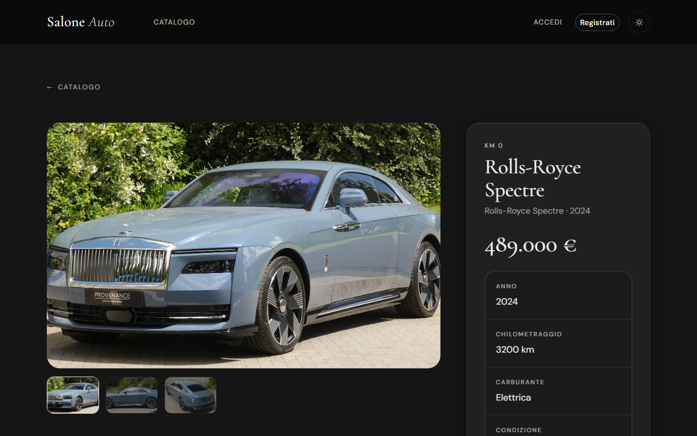
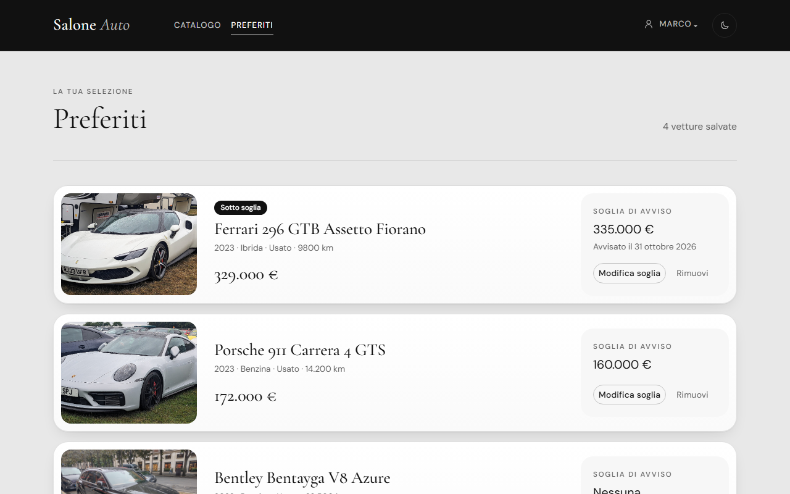
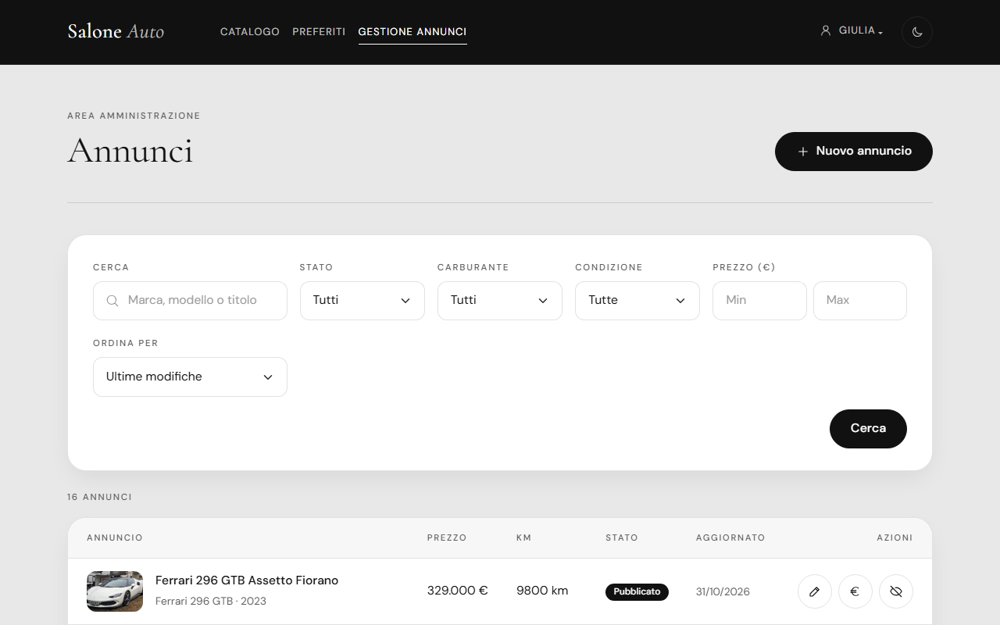
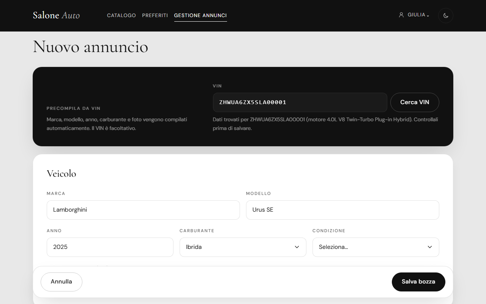

🇬🇧 English · 🇮🇹 [Italiano](README.it.md)

# Luxury Car Showroom

A full-stack web app for a luxury car dealership: a public catalog of listings, a user area with favorites and price-drop alerts by email, and an admin panel to manage listings, with VIN decoding and catalog import from [auto.dev](https://auto.dev).

Built as a course project at [EPICODE Institute of Technology](https://epicode.com): Spring Boot REST API + React SPA. The UI is in Italian.

<p align="center">
  
</p>

<table>
  <tr>
    <td></td>
    <td></td>
  </tr>
  <tr>
    <td align="center">Car detail (dark theme)</td>
    <td align="center">Favorites with price thresholds</td>
  </tr>
  <tr>
    <td></td>
    <td></td>
  </tr>
  <tr>
    <td align="center">Admin: listings</td>
    <td align="center">Admin: listing form prefilled from the VIN</td>
  </tr>
</table>

## Features

**Authentication**
- Sign-up with email verification: the link is valid for 24 hours and can be re-sent; unverified accounts cannot log in.
- Stateless JWT login with email or username; passwords hashed with BCrypt.
- Password reset by email with a single-use link valid for 15 minutes. The response is the same whether or not the account exists, and login timing does not reveal it either.
- Verification and reset tokens are stored only as SHA-256 hashes.

**Roles and protected routes**
- `USER` and `ADMIN` roles, carried in the JWT. `/api/admin/**` requires `ADMIN`; favorites require login.
- The frontend mirrors the rules with route guards (`RequireAuth`, `RequireAdmin`, `GuestOnly`).
- A super admin is created on first startup from environment variables.

**Catalog**
- Server-side filtering (text, fuel type, condition, price range), sorting and pagination.
- Sort fields are whitelisted, and `id` is always added as a tie-breaker so pages stay stable.
- Filters, sorting and page live in the URL, so every search can be bookmarked and shared.
- Detail page with image gallery.

**Favorites and price alerts**
- Users save cars to favorites and can set a price threshold on each one.
- When an admin lowers the price below the threshold, the user gets an email. Each user is notified once; the alert re-arms if the price goes back above the threshold.

**Admin panel**
- Listings table with filters by status, fuel, condition and price.
- Create and edit listings, change the price quickly, and publish or withdraw them: listings are either draft (`BOZZA`) or published (`PUBBLICATO`), and the public catalog shows only published ones.
- VIN decoding: make, model, year, fuel type and photos are prefilled from auto.dev.

**Catalog import**
- Optional seeder that fills an empty catalog with real luxury listings from auto.dev, spread across groups of brands so that the most common ones do not dominate.

**Light and dark theme**
- Follows `prefers-color-scheme` by default; a toggle in the navbar saves the choice.

## Tech stack

| Area | Technology | Version |
|---|---|---|
| Backend | Java | 25 |
| | Spring Boot (Web MVC, Security, Data JPA, Validation, Mail) | 4.1.1 |
| | Spring Security OAuth2 Resource Server (JWT) | from Spring Boot |
| | Thymeleaf (email templates) | from Spring Boot |
| | PostgreSQL | 16 (used in development) |
| | Lombok | from Spring Boot |
| | H2 (tests only) | from Spring Boot |
| Frontend | React | 19.2 |
| | TypeScript | 6.0 |
| | Vite | 8.3 |
| | React Router | 7.18 |
| | Bootstrap + React-Bootstrap | 5.3 / 2.10 |
| | Sass | 1.105 |
| | Oxlint | 1.81 |
| External services | auto.dev API (VIN decoding, photos, listings) | |
| | Mailtrap (SMTP sandbox for development) | |

## Architecture

```
BE/   Spring Boot REST API
  controller/   REST endpoints: /api/auth, /api/cars, /api/me/favorites, /api/admin/**
  service/      business logic (auth, catalog, favorites, password reset, VIN lookup, email)
  repository/   Spring Data JPA repositories and CarSpecifications
  entity/       JPA entities: User, Role, Car, Favorite, tokens
  dto/          request and response records, with Bean Validation
  event/        PrezzoCambiatoEvent (price changed) and PriceAlertListener
  security/     JWT, security rules, ProblemDetail handlers for 401/403
  client/       AutoDevClient (RestClient for auto.dev)
  config/       cache, startup seeders, typed configuration properties
  exception/    exception hierarchy and GlobalExceptionHandler

FE/   React + TypeScript SPA
  src/api/        fetch client with JWT and typed API functions
  src/context/    AuthContext and FavoritesContext
  src/pages/      catalog, detail, favorites, auth pages, admin/
  src/components/ navbar, filters, cards, gallery, guards, theme toggle
  src/utils/      URL-synced filters, async and form hooks, formatting
```

Some technical choices:

- **Price alert after commit.** Changing a price publishes a `PrezzoCambiatoEvent` (price-changed event). `PriceAlertListener` handles it with `@TransactionalEventListener(phase = AFTER_COMMIT)` and `@Async`, so emails go out only if the change was actually saved, and the admin does not wait for SMTP. Each favorite is marked as notified with a conditional `UPDATE`: only the call that wins the update sends the email, so concurrent events cannot send duplicates.
- **JPA Specifications for filters.** `CarSpecifications` builds one `Specification<Car>` from the optional filters and skips those left empty. Public and admin searches share it; the public one always forces published listings.
- **ProblemDetail for errors.** Every API error is returned as `application/problem+json` (RFC 9457): validation errors list the invalid fields, and authentication and authorization failures (401/403) use the same format.
- **Cache for auto.dev.** VIN lookups are cached in memory with Spring Cache (`@Cacheable`), so repeated lookups of the same VIN do not use the limited API quota.
- **Integration tests.** 46 tests in 9 classes cover the auth flow, security rules, catalog filters, admin operations, price alerts and the auto.dev client. They run on an in-memory H2 database, with the mail sender mocked and auto.dev replaced by a local HTTP stub.

## Getting started

### Prerequisites

- JDK 25
- Node.js 20.19 or later
- PostgreSQL
- A [Mailtrap](https://mailtrap.io) inbox to receive verification, reset and price-alert emails
- Optional: an [auto.dev](https://auto.dev) API key, for VIN decoding and catalog import

If you prefer Docker for the database:

```bash
docker run --name salone-db -e POSTGRES_PASSWORD=postgres -e POSTGRES_DB=salone -p 5432:5432 -d postgres:16
```

### 1. Clone

```bash
git clone https://github.com/TheRedKardinal/luxury-car-showroom.git
cd luxury-car-showroom
```

### 2. Backend

```bash
cd BE
cp .env.example .env     # then fill in the values (see below)
./mvnw spring-boot:run   # Windows: mvnw.cmd spring-boot:run
```

The API starts on `http://localhost:8080`. The schema is created automatically, and the super admin is created on first startup from `ADMIN_*`.

### 3. Frontend

```bash
cd FE
cp .env.example .env
npm install
npm run dev
```

The app opens on `http://localhost:5173`. Log in with the admin credentials from `BE/.env`.

The catalog starts empty. You can add listings from the admin panel, or import them from auto.dev by setting `CATALOG_SEED=true` for a single startup and then back to `false`. The import uses 4–8 calls of the auto.dev quota.

### 4. Tests

```bash
cd BE
./mvnw test
```

## Environment variables

Templates: `BE/.env.example` and `FE/.env.example`. The `.env` files are git-ignored.

**Backend (`BE/.env`)**

| Variable | Purpose |
|---|---|
| `DB_URL`, `DB_USERNAME`, `DB_PASSWORD` | PostgreSQL connection |
| `JPA_DDL_AUTO` | Hibernate schema mode (optional, default `update`) |
| `JWT_SECRET` | Key used to sign JWTs (at least 32 characters) |
| `JWT_EXPIRATION` | Token lifetime as an ISO-8601 duration |
| `MAIL_HOST`, `MAIL_PORT`, `MAIL_USERNAME`, `MAIL_PASSWORD` | SMTP server (Mailtrap sandbox in development) |
| `MAIL_FROM` | Sender address of outgoing emails |
| `FRONTEND_URL` | Frontend origin, used for CORS and for links in emails |
| `AUTODEV_API_KEY` | auto.dev API key |
| `CATALOG_SEED` | `true` to import listings from auto.dev into an empty catalog on startup |
| `ADMIN_USERNAME`, `ADMIN_EMAIL`, `ADMIN_PASSWORD` | Super admin created on first startup |
| `ADMIN_NOME`, `ADMIN_COGNOME` | Super admin first and last name (optional) |

**Frontend (`FE/.env`)**

| Variable | Purpose |
|---|---|
| `VITE_API_URL` | Base URL of the backend API |

## Author

Claudio Giasi: [GitHub](https://github.com/TheRedKardinal) · [LinkedIn](https://www.linkedin.com/in/claudio-giasi-8836b5243/)

---

This project is not deployed online: to try it, run it locally by following [Getting started](#getting-started).

Car photos: Wikimedia Commons (CC0)
